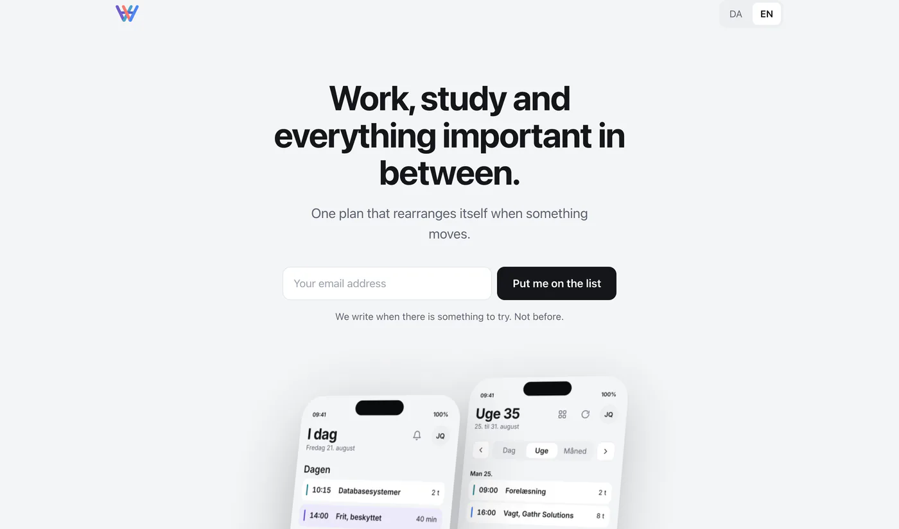
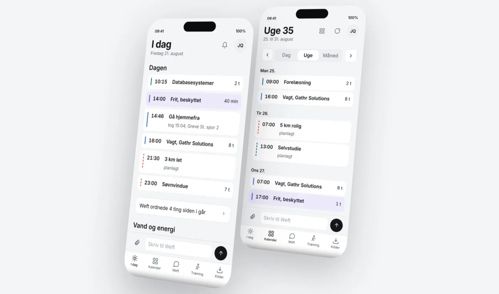

  

  
  
  

> This repository shows the project. The source code is not public.

## What it is

Work, study and training sit in different places. Weft keeps them in one plan and rearranges it when something moves. I build it together with Jawad Qayyum, a fellow software student.

## My part

I worked on the backend in **C#** and **.NET**, on the frontend, and on testing the features we built.

## Running on Azure

The API runs on **Azure App Service** with **Azure SQL** and sign in through **Entra ID**. The platform is live, and the product features are being finished before release. The app is not released yet: it is coming to the App Store and Google Play, and [weft.azurewebsites.net](https://weft.azurewebsites.net) has a waitlist.

## Screenshots

  
   
  <em>The Weft landing page</em>

  
   
  <em>The Weft app: a day and a week of one merged plan</em>

## Stack

  
  
  
  
  

---

Made by [Yasir Lokman Teksen](https://github.com/Teksen42) and Jawad Qayyum. More about me on [teksen42.github.io](https://teksen42.github.io).
